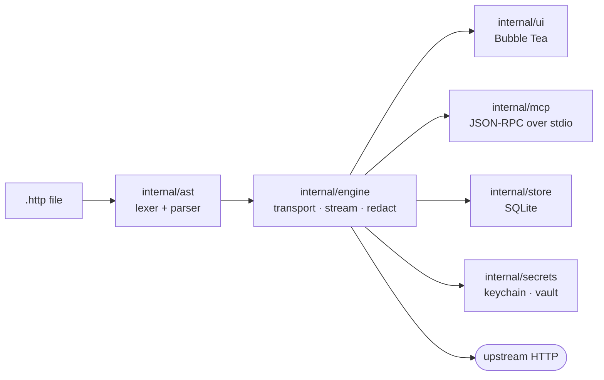

<p align="center">
  
</p>

<p align="center">
  <strong>One CGO-free Go binary. Standard <code>.http</code> files. A TUI for humans, MCP for agents.</strong>
</p>

<p align="center">
  <a href="https://github.com/duckiec/pulse/releases/latest"></a>
  <a href="LICENSE"></a>
  
  
</p>

<p align="center">
  
</p>

Pulse keeps your API collection as plain `.http` files in the repository and resolves secrets at runtime, so no account, sync service, or cloud store sits between you and the request. One engine drives the terminal workbench and a headless MCP server, and every sink scrubs credentials to `[REDACTED]`.

## Installation

**macOS / Linux**

```sh
curl -fsSL https://raw.githubusercontent.com/duckiec/pulse/main/install.sh | sh
```

**Windows (PowerShell)**

```powershell
irm https://raw.githubusercontent.com/duckiec/pulse/main/install.ps1 | iex
```

**From source**

```sh
CGO_ENABLED=0 go build -trimpath -o ./pulse ./cmd/pulse
```

The installers verify `checksums.txt` fail-closed, install into your user bin directory, and self-check with `pulse --version` and `pulse doctor` inside an isolated temp `HOME`.

<details>
<summary>Local build and the full gate suite</summary>

No install, no PATH change, no root. The binary lands at `./pulse` in the repo root (gitignored):

```sh
CGO_ENABLED=0 go build -trimpath -o ./pulse ./cmd/pulse
./pulse --version
./pulse doctor
go vet ./...
bash scripts/all-gates.sh
```

Live keyring tests need a session bus:

```sh
bash scripts/ci/run-with-keyring.sh bash scripts/all-gates.sh
```

</details>

## Quickstart

```sh
pulse init                  # scaffold quickstart.http; refuses to overwrite without --force
pulse api.http              # TUI: j/k scroll, Ctrl+S send, ? help; an empty dir boots a scratchpad
pulse test . --format tap   # headless asserts; exit 0 pass, 1 fail, 2 usage/parse, 3 secret
pulse test . -u             # accept live responses as snapshot baselines
pulse drift openapi.json .  # check the collection against the contract; exit 1 on drift
pulse mock . --from-cache --port 8080          # replay the last successful responses offline
pulse record :9000 --target http://localhost:8080 --out generated.http  # capture live traffic
pulse merge base.http current.http other.http  # semantic 3-way merge (Git driver)
pulse --mcp                 # MCP server over stdio; stdout is protocol only
pulse help vault set        # help for any command
```

A request in `api.http`:

```http
# @name get-user
# @assert status == 200
GET https://localhost:8080/users/1
Accept: application/json

###
```

Blocks end at `###`. Variables are `@base = https://…` and interpolation is `{{base}}`. Bind the merge driver once with `git config merge.pulse.driver "pulse merge %O %A %B"` and add `*.http merge=pulse` to `.gitattributes`; a header on one branch and an assertion on the other then merge instead of conflicting.

## Features

| Capability | Command | Notes |
|---|---|---|
| Terminal workbench | `pulse [file.http]` | Layout, keybindings, and the streaming response pane — [TUI guide](docs/TUI_GUIDE.md) |
| Headless assertions | `pulse test . --format tap` | TAP 13 or JSON; exit codes are semantic — [syntax](docs/HTTP_SYNTAX.md) |
| Snapshot baselines | `# @assert snapshot` | JSON compared structurally, `pulse test -u` accepts — [feature guide](docs/FEATURES.md#snapshot-assertions) |
| Branch environments | `.env.pulse` | `{{BASE_URL}}` follows the checkout — [feature guide](docs/FEATURES.md#git-aware-environments) |
| Contract drift | `pulse drift openapi.json .` | Static check against OpenAPI 3.x, nothing is sent |
| Traffic capture | `pulse record` | Reverse proxy that writes `.http` blocks with secrets redacted |
| Offline replay | `pulse mock --from-cache` | Serves the last 2xx per route from local SQLite |
| Semantic merges | `pulse merge` | Request- and field-level three-way merge |
| Agent firewall | `.pulse-guard` | Methods, hosts, and rate, checked before dispatch — [MCP guide](docs/MCP_GUIDE.md) |
| Sandboxed scripts | `# @wasm`, `@wasm-sign` | Wazero, zero ambient authority — [hooks](docs/FEATURES.md#wasm-request-hooks) |

### Guarantees

| Pillar | What holds |
|---|---|
|  Offline | Works on an airplane. No socket to Pulse infrastructure exists to open. |
|  Git-native | Collections are text. Review and merge them like code. |
|  Dual-mode | TUI and MCP share the engine. Define a request once, drive it from either. |
|  Single binary | One CGO-free executable on Linux, macOS, Windows (`CGO_ENABLED=0 go build ./...`, Go 1.27+). |

Measured budgets, not marketing numbers: a 2 MiB in-flight streaming ceiling (`internal/engine/stream.go`, 64 × 32 KiB pooled chunks), a 1 MiB UI tail, and no telemetry. The only server-side state Pulse keeps is local SQLite — history metadata plus a bounded, redacted replay cache — and it refuses secret-capable columns at every open.

<details>
<summary>Secret resolution order and redaction</summary>

`{{PLACEHOLDER}}` references resolve in this order:

1. OS keychain
2. Git-aware `.env.pulse` (branch block, then `[default]`)
3. ephemeral in-memory `.env`
4. sealed `.pulse.vault` (0600, device key in the keyring)
5. hard error, exit `3`

Raw values stay out of files, the store, and logs. Every sink scrubs `Authorization`, `Proxy-Authorization`, `Cookie`, `Set-Cookie`, `X-Api-Key`, plus every sealed value, to `[REDACTED]`: stderr, store rows, UI, MCP output. Outbound requests carry the real secret; diagnostic copies never do.

</details>

<details>
<summary>MCP tool catalog (16 tools)</summary>

| Tool | What it does |
|---|---|
| `execute_request` | Run one request (inline payload or repo path); returns status, headers, chunked body |
| `execute_fuzz_run` | Dispatch one fuzzed request against a target |
| `list_collections` | List `.http` files in the workspace |
| `list_requests` | List named requests across collections |
| `get_request` | Fetch one request definition by ref |
| `get_run` | Fetch a past run by `run_id` |
| `get_history` | Recent runs, newest first |
| `fuzz_start` | Open an iterative fuzz session over an OpenAPI subset |
| `fuzz_next` | Pull the next fuzz case from the session |
| `fuzz_report` | Close the session with a TAP 13 report |
| `get_http_syntax_spec` | Authoritative `.http` grammar and `{{VAR}}` rules |
| `create_collection` | Create a workspace `.http` file (jailed, never overwrites) |
| `upsert_request` | Create or replace one named request block (lossless splice) |
| `delete_request` | Delete one named request block |
| `import_curl` | Import a curl command sanitized (secrets become placeholders) |
| `validate_collection` | Syntax diagnostics plus present-vs-missing `{{SECRET}}` check (names only) |

The server refuses literal credentials and tells you to run `pulse vault set`. A `.pulse-guard` file caps the agent's blast radius: methods, hosts, and a request rate, checked before dispatch, with loopback-only hosts when no file exists. A blocked call returns `BLOCKED BY POLICY: …` as text the model can act on. Recipes are in the [MCP cookbook](docs/MCP_COOKBOOK.md).

</details>

## Architecture



The UI thread never does I/O: network and disk run in background commands and stream back as messages, so keystrokes stay instant while a large body lands in bounded 32 KiB chunks.

<details>
<summary>Codebase topology</summary>

| Package | Purpose |
|---|---|
| `cmd/pulse/` | Mode selection (`mcp`, `test`, `drift`, `merge`, `mock`, `record`, `vault`, `init`, `doctor`, `sync`), exit codes |
| `internal/ast/` | `.http` lexer and parser, no I/O |
| `internal/engine/` | Transport, streaming, redaction, drift matcher, three-way merge, pre-dispatch hook and policy seams |
| `internal/store/` | SQLite history (`modernc.org/sqlite`, CGO-free) |
| `internal/secrets/` | Keychain bindings, vault, redaction |
| `internal/rag/` | Local codebase index |
| `internal/fuzz/` | OpenAPI subset reader, boundary matrix, TAP 13 |
| `internal/mcp/` | JSON-RPC server over stdio |
| `internal/sync/` | P2P collection sync (HLC + CRDT, mTLS TOFU, zeroconf) |
| `internal/wasm/` | Sandboxed WASM signers and hooks (wazero, no ambient authority) |
| `internal/ui/` | Bubble Tea models, Lip Gloss styling |
| `internal/app/` | Composition root, lifecycle |

</details>

## Documentation

| Document | Read it for |
|---|---|
| [QUICKSTART.md](docs/QUICKSTART.md) | Five minutes to your first request, snapshot, and guarded agent |
| [FEATURES.md](docs/FEATURES.md) | Branch environments, snapshots, drift, capture, replay, merges, hooks, firewall |
| [HTTP_SYNTAX.md](docs/HTTP_SYNTAX.md) | The `.http` grammar: variables, directives, assertions, signing |
| [TUI_GUIDE.md](docs/TUI_GUIDE.md) | Panes, keybindings, composer, vault, fuzz dashboard |
| [MCP_COOKBOOK.md](docs/MCP_COOKBOOK.md) | Driving Pulse from an AI agent: tools and recipes |
| [MCP_GUIDE.md](docs/MCP_GUIDE.md) | `.pulse-guard` reference and the blast-radius firewall |

## License

GNU AGPLv3. See [LICENSE](LICENSE).
