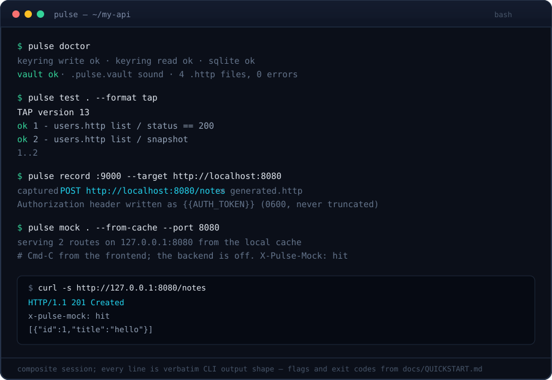

<p align="center">
  
</p>

<p align="center">
  <a href="https://github.com/duckiec/pulse/actions/workflows/ci.yml"></a>
  <a href="go.mod"></a>
  <a href="LICENSE"></a>
  <a href="scripts/ci/build-matrix.sh"></a>
</p>

<p align="center">

The offline, Git-native API workbench.

```sh
curl -fsSL https://raw.githubusercontent.com/duckiec/pulse/main/install.sh | sh
```

```powershell
irm https://raw.githubusercontent.com/duckiec/pulse/main/install.ps1 | iex
```

[Quickstart](docs/QUICKSTART.md) · [Features](docs/FEATURES.md) · [HTTP syntax](docs/HTTP_SYNTAX.md) · [TUI guide](docs/TUI_GUIDE.md) · [MCP cookbook](docs/MCP_COOKBOOK.md)

</p>

---

Cloud API clients store your collections on someone else's server and your tokens in their sync. Pulse keeps requests as plain `.http` files in your repo and resolves secrets at runtime. One engine drives a terminal UI for humans and a 16-tool MCP server for local agents. You create no account. Pulse sends no telemetry and opens no connection to Pulse infrastructure.

You stream a 50 MB response in bounded 32 KiB chunks under a 2 MiB in-flight ceiling, and the UI stays responsive. You seal secrets in the OS keychain, an ephemeral in-memory `.env`, or a sealed `.pulse.vault`. Raw values stay out of files, the store, and logs.

<p align="center">
  
</p>

## Quickstart

Install (above), then:

```sh
pulse init                  # scaffold quickstart.http; refuses to overwrite without --force
pulse api.http              # TUI: j/k scroll, Ctrl+S send, ? help; empty dir boots a scratchpad
pulse --mcp                 # MCP server over stdio (alias of `pulse mcp`); stdout is protocol only
pulse test . --format tap   # headless asserts; exit 0 pass, 1 fail, 2 usage/parse, 3 secret
pulse test . -u             # accept live responses as snapshot baselines
pulse drift openapi.json .  # check the collection against the contract; exit 1 on drift
pulse help                  # help for any command: `pulse help vault set`
```

A request in `api.http`:

```http
# @name get-user
# @assert status == 200
GET https://localhost:8080/users/1
Accept: application/json

###
```

Blocks end at `###`. Variables are `@base = https://…`, interpolation is `{{base}}`, signing is a bare `@wasm-sign ./sign/auth.wasm` line (one per request). Add `# @assert snapshot` to a named request and Pulse keeps its response in an adjacent `.http.snap` file for structural regression runs. A `.env.pulse` file selects `BASE_URL` by branch, so a checkout changes the environment without a toggle. Seal a token without leaving the terminal: `pulse vault set DEMO_TOKEN` (prompts with no echo, or reads piped stdin). Check the workspace: `pulse doctor`.

## Guarantees

| Pillar | What holds |
|---|---|
|  Offline | Works on an airplane. No socket to Pulse infrastructure exists to open. |
|  Git-native | Collections are text. Review and merge them like code. |
|  Dual-mode | TUI and MCP share the engine. Define a request once, drive it from either. |
|  Single binary | One CGO-free executable on Linux, macOS, Windows (`CGO_ENABLED=0 go build ./...`, Go 1.27+). |

This README publishes no startup-time figure and no rival memory number. The repo measures neither. The measured budgets are the 2 MiB in-flight streaming ceiling (`internal/engine/stream.go`: 64×32 KiB pooled chunks), the 1 MiB UI tail, and the offline/no-telemetry invariant. Cloud alternatives require accounts and store collections server-side; Pulse stores history metadata in local SQLite and refuses secret-capable columns at every open.

You resolve secrets in this order: `keychain → Git-aware .env.pulse → ephemeral in-memory .env → sealed .pulse.vault → hard error (exit 3)`. You write `{{PLACEHOLDER}}` references in files and keep raw values out. Every sink scrubs `Authorization`, `Proxy-Authorization`, `Cookie`, `Set-Cookie`, `X-Api-Key`, plus every sealed value, to `[REDACTED]`: stderr, store rows, UI, MCP output. Outbound requests carry the real secret; diagnostic copies never do.

The MCP server exposes 16 tools: `execute_request`, `execute_fuzz_run`, `list_collections`, `list_requests`, `get_request`, `get_run`, `get_history`, `fuzz_start`, `fuzz_next`, `fuzz_report`, `get_http_syntax_spec`, `create_collection`, `upsert_request`, `delete_request`, `import_curl`, `validate_collection`. The server refuses literal credentials and tells you to run `pulse vault set`. A `.pulse-guard` file caps the agent's blast radius: methods, hosts, and a request rate, checked before dispatch, with loopback-only hosts when no file exists. A blocked call returns `BLOCKED BY POLICY: …` as text the model can act on.

## Build (local directory only)

No install, no PATH changes, no root needed. The binary lands at `./pulse` in the repo root (gitignored) and stays there:

```sh
CGO_ENABLED=0 go build -trimpath -o ./pulse ./cmd/pulse
./pulse --version
./pulse doctor
```

Full checks, still local:

```sh
go vet ./...
bash scripts/all-gates.sh
```

Live keyring tests need a session bus:

```sh
bash scripts/ci/run-with-keyring.sh bash scripts/all-gates.sh
```

## Docs

- [QUICKSTART.md](docs/QUICKSTART.md) — five minutes to your first request
- [HTTP_SYNTAX.md](docs/HTTP_SYNTAX.md) — the `.http` file format
- [TUI_GUIDE.md](docs/TUI_GUIDE.md) — keybindings, panes, streaming views
- [MCP_COOKBOOK.md](docs/MCP_COOKBOOK.md) — driving Pulse from an AI agent

<details>
<summary>Codebase topology</summary>

| Package | Purpose |
|---|---|
| `cmd/pulse/` | Mode selection (`mcp`, `test`, `vault`, `init`, `doctor`, `sync`), exit codes |
| `internal/ast/` | `.http` lexer and parser, no I/O |
| `internal/engine/` | Transport, streaming, redaction |
| `internal/store/` | SQLite history (`modernc.org/sqlite`, CGO-free) |
| `internal/secrets/` | Keychain bindings, vault, redaction |
| `internal/rag/` | Local codebase index |
| `internal/fuzz/` | OpenAPI subset reader, boundary matrix, TAP 13 |
| `internal/mcp/` | JSON-RPC server over stdio |
| `internal/sync/` | P2P collection sync (HLC + CRDT, mTLS TOFU, zeroconf) |
| `internal/wasm/` | Sandboxed WASM signers (wazero, no ambient authority) |
| `internal/ui/` | Bubble Tea models, Lip Gloss styling |
| `internal/app/` | Composition root, lifecycle |

</details>

## License

GNU AGPLv3. See `LICENSE`.
